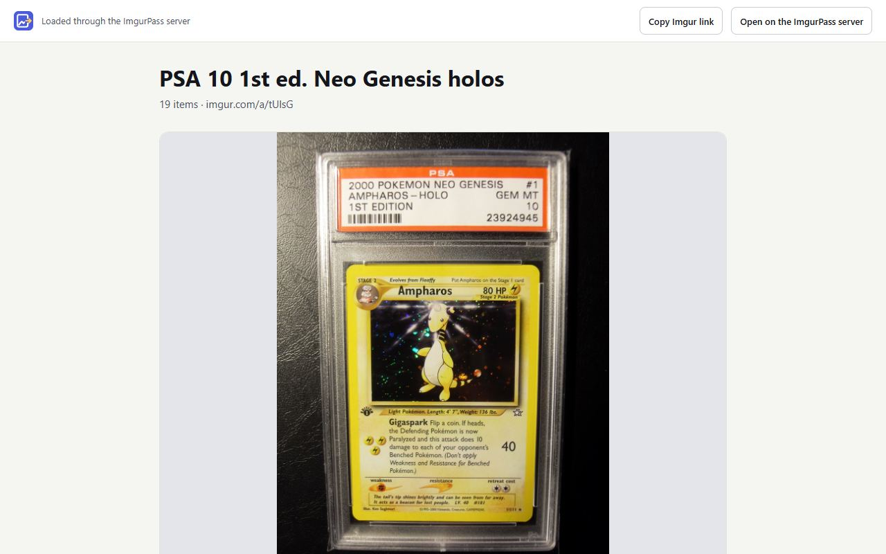
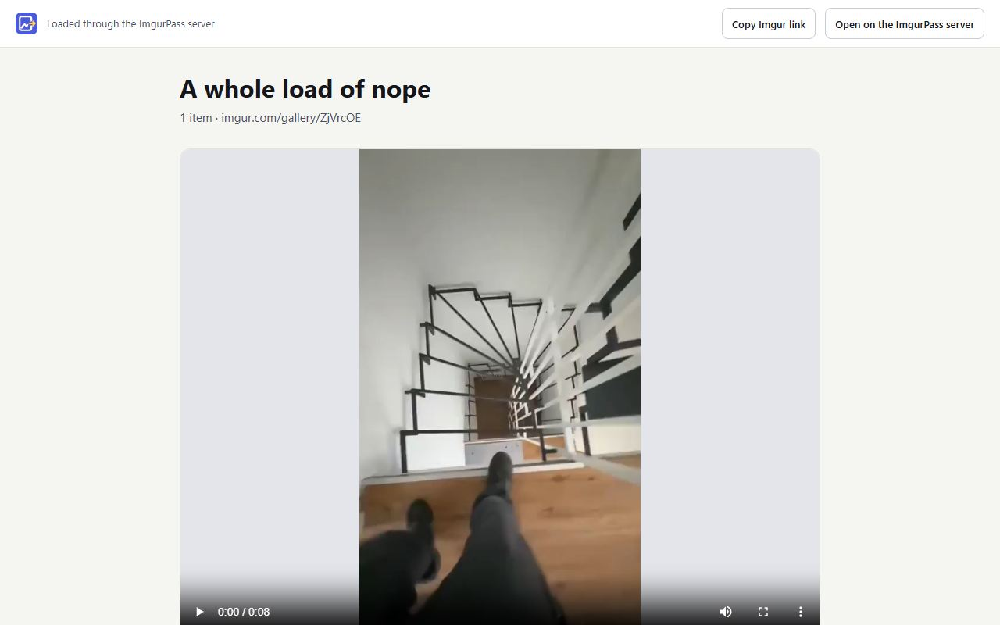
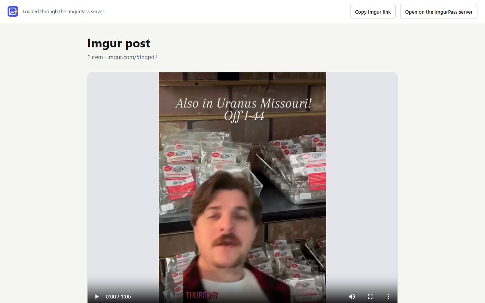
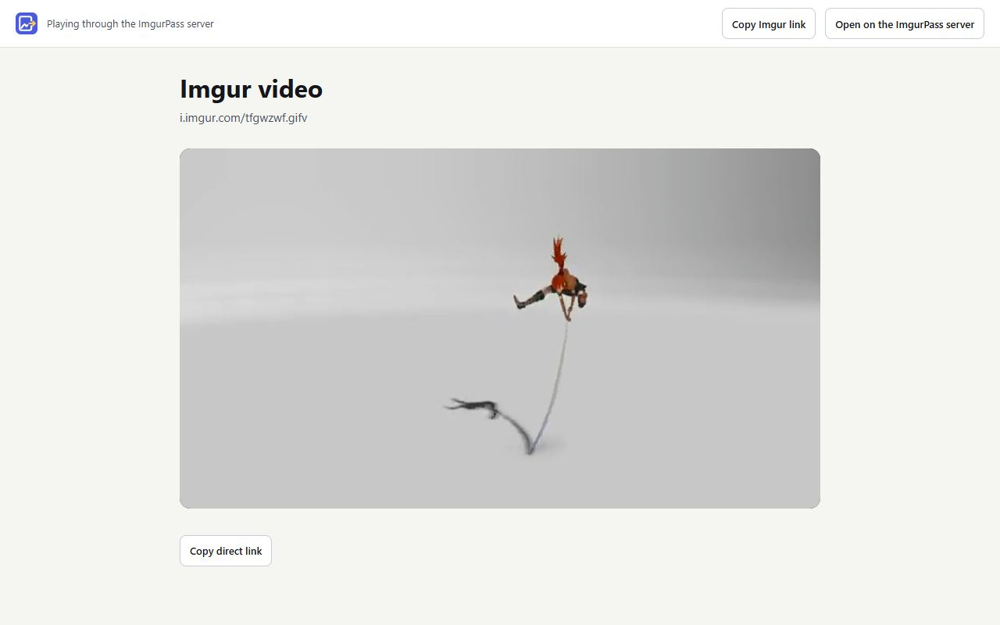
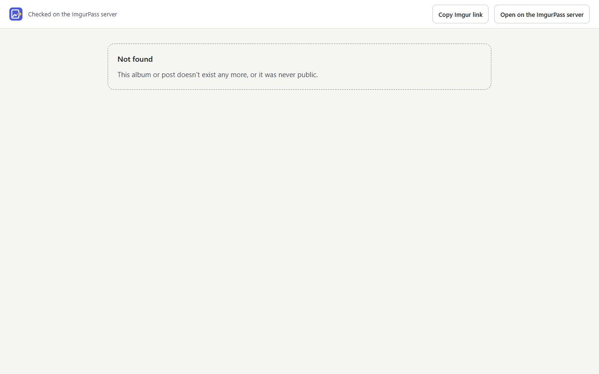
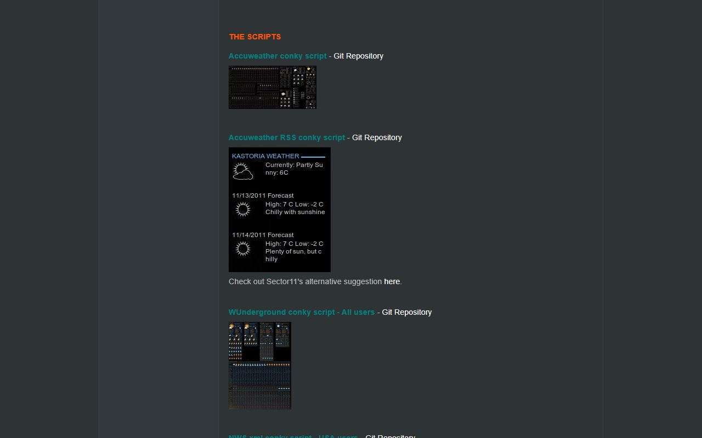
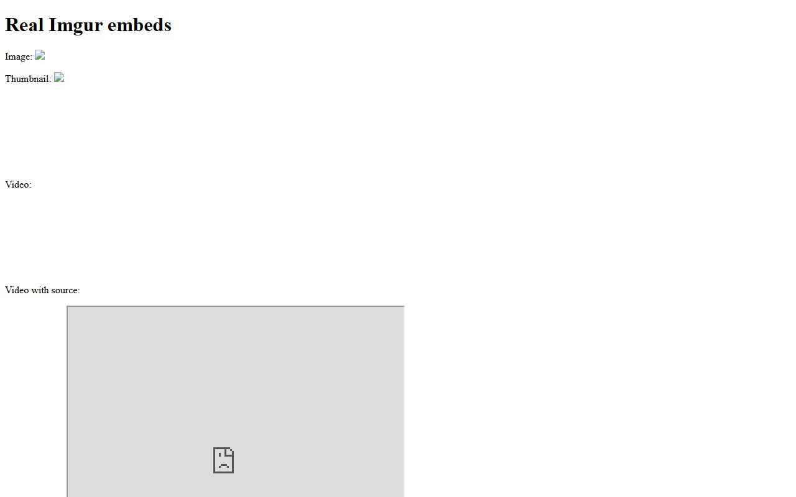
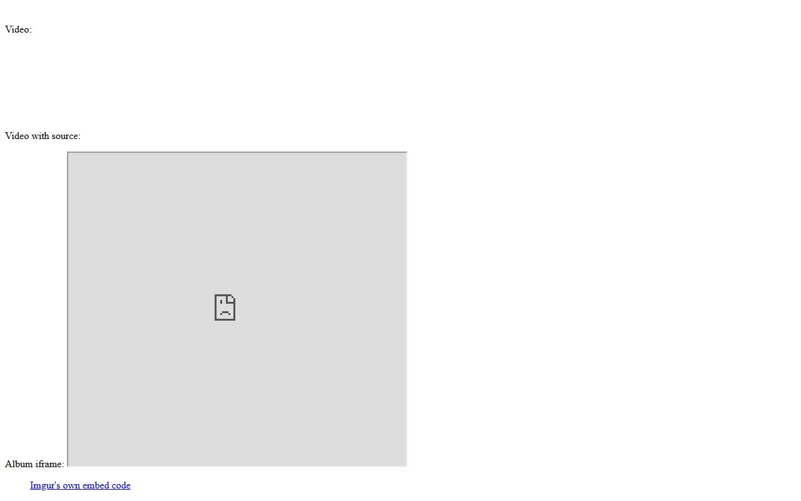
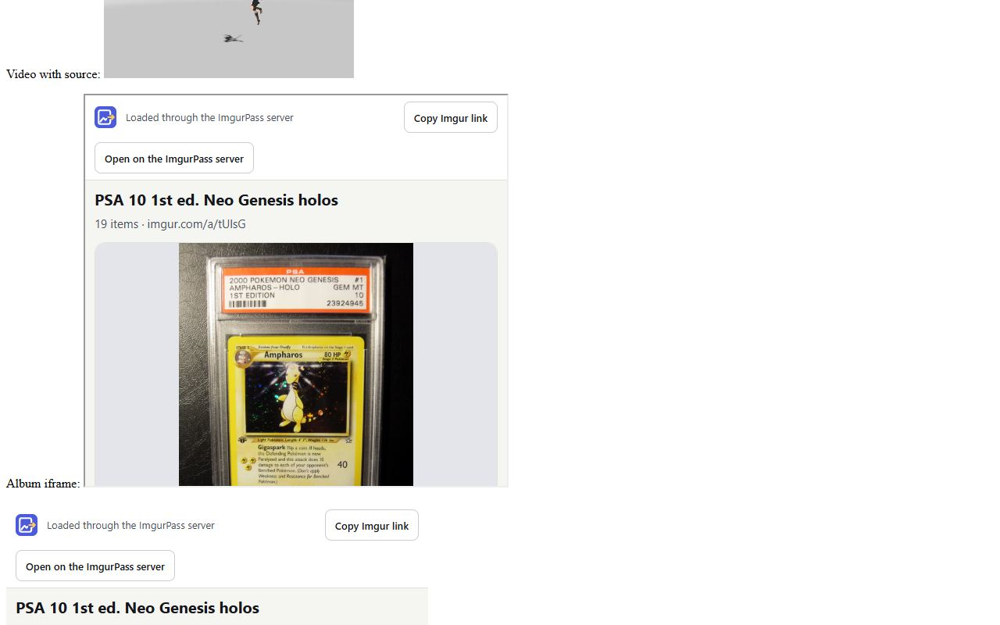

# ImgurPass: before and after

The same real Imgur links, opened from the UK (where Imgur is blocked) in Chromium without ImgurPass and then with it. "After" uses ImgurPass 0.1.0 with its default settings plus access to all sites, so embeds on other sites are fixed too.

Screenshots are 1280×800 and live in [`comparison/`](comparison).

## Direct image link

`https://i.imgur.com/dqxZm2Y.jpeg`

| Before | After |
| --- | --- |
|  |  |
| Imgur swaps the image for its "Content not viewable in your region" placeholder. | The real image, through the DuckDuckGo image proxy. |

## Album

`https://imgur.com/a/tUlsG`

| Before | After |
| --- | --- |
|  |  |
| Imgur's "Content Not Available" page. | All 19 items in the ImgurPass viewer, read from the ImgurPass server. Click an image to see it full size. |

## Gallery post

`https://imgur.com/gallery/whole-load-of-nope-ZjVrcOE`

| Before | After |
| --- | --- |
|  |  |
| Imgur's "Content Not Available" page. | The post (a short video) in the viewer, with its title. |

## Single post (video)

`https://imgur.com/5fhqpd2`

| Before | After |
| --- | --- |
|  |  |
| Imgur's "Content Not Available" page. | The post in the viewer. Videos in posts and albums get the browser's player: play, seek, volume and fullscreen. |

## Video link

`https://i.imgur.com/tfgwzwf.gifv`

| Before | After |
| --- | --- |
|  |  |
| Imgur's "Content Not Available" page. | The video playing in the viewer, through the ImgurPass server. |

## Deleted post

`https://imgur.com/4t4yzHk`

| Before | After |
| --- | --- |
|  |  |
| Imgur's "Content Not Available" page, which hides that the post is gone. | The viewer says plainly that the post doesn't exist any more. |

## Images embedded on a forum

[BunsenLabs forum thread](https://forums.bunsenlabs.org/viewtopic.php?pid=1545)

| Before | After |
| --- | --- |
|  |  |
| Every embedded Imgur image is the region placeholder. | The real screenshots, through the DuckDuckGo image proxy. |

The toolbar button on that page:

## Embeds on any page: images, videos and albums

A plain test page that embeds real Imgur media: an image, a thumbnail, a `<video>` (twice, with `src` and with `<source>`), an album `<iframe>`, and Imgur's own embed code (a blockquote plus a script from `s.imgur.com`).

| Before | After |
| --- | --- |
|  |  |
| Images and videos don't load at all. | Images load through DuckDuckGo, videos through the ImgurPass server. |
|  |  |
| The album iframe fails, and Imgur's embed code stays a bare link because its script can't load. | Both become the ImgurPass viewer, showing the album in place. |
